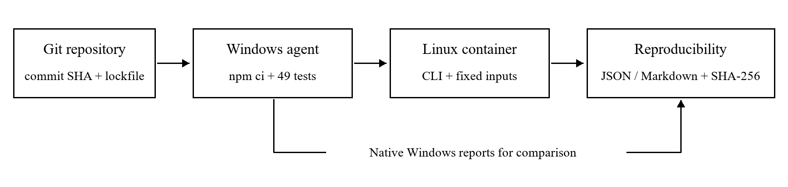

# Контейнеризация и непрерывная интеграция модуля оценки обнаружения атак в IIoT

Онгарбай Нурторе · Astana IT University · CSE-2504M

**Аннотация.** Представлен процесс контейнерной сборки и непрерывной интеграции исследовательского модуля оценки обнаружения атак в промышленном интернете вещей. Ранее реализованный TypeScript CLI дополнен многостадийным Docker-образом, локальным Jenkins и декларативным pipeline. На фиксированных синтетических входных данных сопоставлены результаты выполнения в Windows и Linux-контейнере. Все шесть сравнений SHA-256 для JSON- и Markdown-отчётов в трёх контейнерных запусках подтвердили побайтовое совпадение. Исходная версия прошла 49 автоматических тестов; намеренное искажение формулы F1 вызвало отказ четырёх тестов и блокировку последующих стадий. После отмены дефекта автоматический запуск Jenkins завершился успешно. Полученные результаты характеризуют воспроизводимость вычислительной процедуры и обнаружение выбранной регрессии в условиях локального стенда.

## 1 Введение

В исследовании систем обнаружения атак вычисление метрик связывает выходные данные детектора с выводами об исследуемом подходе. Изменение среды выполнения, версии зависимости или процедуры подготовки отчёта способно нарушить сопоставимость экспериментов. Поэтому вместе с алгоритмом оценки требуется сохранять исходные данные, версии программ и последовательность преобразований. Учёт происхождения результатов и контроль версий вычислительных сценариев входят в рекомендации по воспроизводимым вычислительным исследованиям [1].

Настоящая работа продолжает разработку исследовательского прототипа IIoT, в котором рассматриваются edge-обработка и федеративное обучение для трёх моделируемых сегментов: освещения, насосной станции и экологического мониторинга. В предшествующих этапах определены требования и архитектура, разработан модуль оценки сохранённых предсказаний, рассмотрены ресурсы дальнейшего исследования. В качестве программного задела используется IIoT Detection Evaluation Toolkit версии 1.0.0 [2].

Цель данного этапа состоит в создании проверяемого процесса сборки и выполнения модуля в контейнерной среде с автоматическим контролем интеграции. Исследовательский вопрос сформулирован следующим образом: сохраняются ли результаты CLI при переходе из Windows в Linux-контейнер и обнаруживает ли локальный pipeline Jenkins намеренно внесённый вычислительный дефект? Проверка ограничена инфраструктурой модуля оценки; разработка детектора и обучение моделей не включены в эксперимент.

## 2 Материалы и методы

Модуль принимает CSV с идентификатором наблюдения, сегментом, истинной и предсказанной бинарными метками, версией модели и необязательной задержкой. После проверки схемы и согласованности выборок вычисляются матрица ошибок, precision, recall, F1, false positive rate и accuracy. Для предоставленных значений задержки определяется p95 по правилу ближайшего ранга. Отчёты формируются в JSON и Markdown; в них включены SHA-256 входных файлов и версия инструмента. Даты и абсолютные пути в отчёты не записываются, что позволяет проверять их побайтовую повторяемость [2].

Использованы два авторских синтетических файла по 12 наблюдений, содержащих одинаковые идентификаторы, сегменты и истинные метки. Значения предсказаний и задержек заданы вручную. Файлы служат контролируемыми примерами вычислений и не являются результатами обучения локальной или федеративной модели. Совпадение входов между режимами выполнения проверялось по SHA-256. В обоих режимах выполнялась одна и та же скомпилированная версия CLI на Node.js 22.19.0.

Таблица 1 Характеристики экспериментального стенда

| Компонент | Зафиксированная конфигурация |
|---|---|
| Операционная система | Windows 11 Pro, 64 bit, сборка 26200 |
| Процессор и память | AMD Ryzen 5 4600H, 12 логических процессоров; 23,37 GiB RAM |
| Среда выполнения | Node.js 22.19.0; npm 11.12.0 на Windows |
| Контейнерная среда | Docker Desktop 4.85.0; Engine 29.6.2; Linux amd64 |
| Сервер интеграции | Jenkins LTS 2.580.1; Java 21.0.10; 68 закреплённых версий плагинов |
| Базовый образ | node:22.19.0-bookworm-slim, закреплённый по digest |
| Состав испытаний | 49 существующих тестов; два CSV; три повторных контейнерных запуска |

Исходная установка воспроизводилась посредством npm ci с сохранённым package-lock.json. Зависимости проекта при выполнении работы не изменялись. Контролировались чистота checkout, версия Node.js, доступность Docker Engine и ревизия исходного кода. В метаданные каждой сборки включались фактическое время выполнения, версии программ, хеш lockfile и хеши входных файлов. Отсутствие изменений в рабочем дереве проверялось до установки зависимостей.

Экспериментальный протокол включал успешный запуск исходной версии, сопоставление нативного выполнения с контейнерным, три повторения контейнерного запуска, обработку некорректного CSV и проверку реакции CI на дефект. Для каждого из двух файлов отчёта вычислялась величина H = SHA-256(bytes). Условием эквивалентности являлось равенство H Windows и H container во всех трёх повторениях. Здесь повторяемость относится к фиксированной реализации и контролируемым входам; независимое воспроизведение результата другой исследовательской группой не проводилось.

В отдельной экспериментальной ветке формула F1 = 2TP / (2TP + FP + FN) заменялась на 2TP / (TP + FP + FN). Изменение сохраняет корректность типов, но нарушает смысл вычисления, поэтому оно подходит для проверки существующих тестов. После зарегистрированного отказа изменение отменялось отдельным коммитом. Определение Jenkinsfile в основном и экспериментальном заданиях было одинаковым. Автоматический запуск проверялся по причине сборки, зарегистрированной Jenkins как Started by an SCM change.

## 3 Организация контейнерного выполнения и непрерывной интеграции

Dockerfile содержит стадии компиляции, установки production dependencies и формирования образа выполнения. Зависимости устанавливаются по lockfile; компилятор TypeScript и тестовые инструменты в финальный образ не переносятся. Разделение стадий использует механизм многостадийной сборки Docker [3]. Базовый образ закреплён по digest, а тег создаваемого образа содержит сокращённый commit SHA и номер сборки Jenkins. Это связывает артефакт с проверенной ревизией без предположения об идентичности байтов повторно собранных образов.

В образ переносятся dist, production-зависимости, описание пакета, лицензия и демонстрационные данные. Сохранение package.json необходимо, поскольку CLI извлекает из него версию инструмента во время выполнения. Процесс запускается как пользователь node. Входные данные монтируются только для чтения, результаты записываются в отдельный каталог. Экспериментальные запуски используют файловую систему контейнера только для чтения, отключённую сеть и удалённые Linux capabilities. CLI не предоставляет HTTP-сервис и не требует публикации порта.

Jenkins установлен локально из официального WAR-файла с проверкой SHA-256 [4]. Применена совместимая Java 21 [5]. Контроллер слушает loopback-интерфейс; анонимный доступ отключён. Сборки выполняются отдельным Windows-агентом с меткой windows-docker, при нулевом числе executors контроллера. Такой выбор соответствует рекомендации Jenkins выносить сборки за пределы встроенного узла [6]. Агент и контроллер работают под одной Windows-учётной записью, поэтому разделение процессов не создаёт изоляции на уровне учётных записей.

Рисунок 1 Поток проверки исходной ревизии и эквивалентности результатов

Jenkins получает Jenkinsfile непосредственно из GitHub через Pipeline script from SCM. Процесс хранится вместе с кодом и проходит тот же контроль версий [7]. Изменения обнаруживаются опросом SCM раз в минуту. Для обработки Windows-команд используется npm.cmd; ненулевой код завершения обязательного шага приводит к отказу pipeline. Конфигурация контроллера и секреты размещены вне репозитория. Рабочий каталог агента расположен в профиле пользователя, доступном Docker Desktop для bind mounts.

Таблица 2 Последовательность обязательных стадий

| Стадия | Контролируемое условие |
|---|---|
| Checkout и Environment | Чистая ревизия, версии программ и доступный Docker Engine |
| Dependencies и Typecheck | Установка по lockfile и корректность типов |
| Tests | 49 тестов с экспортом результатов в JUnit XML |
| Native evaluation | JSON и Markdown при запуске CLI в Windows |
| Docker build | Сборка образа и фиксация его идентификатора и размера |
| Container evaluation | Три выполнения на тех же CSV и отклонение повреждённых данных |
| Reproducibility | Шесть сравнений SHA-256 выходных файлов |
| Package и post actions | Упаковка после проверок; сохранение доступных логов и артефактов при любом исходе |

Артефакты содержат результаты тестов, отчёты обоих режимов выполнения, параметры образа и контрольные суммы. При отказе Tests стадии оценки, сборки образа и Package пропускаются, а JUnit и диагностические данные сохраняются. Существующая проверка GitHub Actions на Windows и Linux продолжает работать независимо от локального Jenkins. Публикация Docker-образа в registry и развёртывание внешнего сервиса в этот процесс не включены.

## 4 Результаты

Основной набор результатов получен в задании iiot-assignment-5, сборка № 4, для ревизии eec77f4963be768cdf461619e53fd88dae73a7f2. Сборка запущена механизмом SCM polling и завершилась со статусом SUCCESS. Общая длительность составила 36,690 с. Все 49 тестов пройдены. Экспорт JUnit и сохранение npm-архива выполнены после обязательных проверок. Запуск GitHub Actions для той же ревизии также завершился успешно на Windows и Linux; его идентификатор сохранён в материалах эксперимента.

Таблица 3 Результаты экспериментальных сценариев

| Сценарий | Наблюдение | Свидетельство |
|---|---|---|
| E1 Исходная версия | 49 из 49 тестов пройдены | main № 4; tests.xml |
| E2 Windows и Linux | Оба отчёта совпали побайтово | reproducibility.json |
| E3 Повторение | Совпадение в трёх запусках; 6 из 6 сравнений | main № 4 |
| E4 Некорректный CSV | Exit code 1; новые отчёты отсутствуют | negative.json |
| E5 Ошибка F1 | 4 отказа из 49 тестов; последующие стадии пропущены | regression № 2 |
| E6 Отмена дефекта | 49 тестов пройдены; pipeline SUCCESS | regression № 3 |
| E7 Запуск по SCM | Причина Started by an SCM change | main № 4; regression № 3 |

В каждом контейнерном запуске получены одинаковые файлы report.json и report.md. Таблица 4 содержит их полные хеши, совпавшие с результатами Windows. Неизменность отчётов при повторении подтверждена на фиксированной паре CSV. Для повреждённого CSV зарегистрировано сообщение Missing column: sample_id и код завершения 1; выходные файлы в отдельном пустом каталоге не появились.

Таблица 4 SHA 256 совпавших выходных файлов

| Файл | SHA-256 |
|---|---|
| report.json | 745e31426d4464ad3862902e6d2d624fe407e7e12a0b96babfc4ac4a1c90f2ba |
| report.md | 77403724396688f403b51d4420b0217fe006375cda20d3577e462015e3bbb6a0 |

Размер финального образа по docker image inspect составил 79 290 903 байт, или 79,29 MB. Пользователь образа — node; версия Node.js внутри контейнера — v22.19.0. Длительность сборки с доступным кешем составила 1,846 с. Измерение не характеризует сборку без кеша и не используется для вывода об ускорении многостадийного подхода.

Таблица 5 Длительность запусков CLI на стенде

| Режим | Время с |
|---|---|
| Windows CLI, один запуск | 0,102 |
| Контейнер, повтор 1 | 0,846 |
| Контейнер, повтор 2 | 0,816 |
| Контейнер, повтор 3 | 0,835 |
| Медиана трёх контейнерных запусков | 0,835 |

Время контейнерного выполнения включает создание контейнера и операции с монтируемыми каталогами. Единственный нативный запуск не образует сопоставимую статистическую выборку. Поэтому приведённые значения описывают наблюдения на стенде и не позволяют оценить относительную производительность режимов или задержку обнаружения атак.

Намеренно внесённая ошибка F1 сохранена коммитом 35c4934 в экспериментальной ветке. В задании iiot-assignment-5-regression, сборка № 2, отказали четыре теста, включая проверки расчёта метрик и полного CLI. Стадии Docker build и Package были пропущены; npm-архив для этой сборки не создан. Коммит 95b1e63 отменил дефект. Следующая сборка № 3 была автоматически запущена по изменению SCM и прошла все стадии, что подтверждает восстановление процесса после исправления.

## 5 Обсуждение

Полученные данные отвечают на исследовательский вопрос в пределах выбранного протокола. Закреплённая реализация формирует одинаковые отчёты в Windows и Linux-контейнере, а существующие тесты обнаруживают выбранное искажение формулы. Ненулевой код тестового шага распространяется на статус сборки и блокирует выпуск артефакта. Совместное использование контрольных сумм, JUnit и идентификаторов ревизий позволяет установить, какие данные и какая версия кода породили конкретный результат.

Локальный Jenkins дополняет существующий GitHub Actions проверкой Docker Desktop и доступности каталогов на данном Windows-хосте. При настройке обнаружено, что каталог агента внутри AppData отображался пустым в bind mount. Перенос workspace в доступный каталог профиля устранил это ограничение. В архиве сохранены также неуспешные установочные запуски; они отделены от контролируемого эксперимента с F1. Этот случай показывает необходимость проверять фактический доступ контейнера к данным, а не ограничиваться наличием Docker CLI.

Результаты ограничены одним компьютером, одной архитектурой процессора и небольшими синтетическими файлами. Не исследованы изменение порядка строк, другие CSV-кодировки в межплатформенном сравнении, крупные наборы данных и независимый повтор на другом хосте. Три запуска подтверждают повторяемость для данных условий и не дают основания оценивать надёжность pipeline вероятностно. Один внесённый дефект также не характеризует полноту покрытия всех возможных ошибок.

Фиксация базового digest и lockfile уменьшает изменчивость программной среды, однако будущая сборка по-прежнему зависит от доступности registry и npm-пакетов. Эксперимент устанавливает равенство выходных файлов, а не воспроизводимость бинарного Docker-образа. Контроллер и агент имеют общую Windows-учётную запись; переход к промышленному использованию потребует иного разграничения доступа и самостоятельной оценки эксплуатационных требований.

Синтетические метрики остаются проверкой вычислительной процедуры. Они не подтверждают точность обнаружения атак в реальном IIoT-трафике, преимущество федеративного обучения или выполнение требований к edge-задержке. Дальнейшее развитие исследования должно включать разрешённые реальные данные, протокол разделения выборок и повтор эксперимента на независимом стенде с теми же исходными хешами и зафиксированной ревизией.

## 6 Заключение

Разработан и проверен локальный процесс непрерывной интеграции IIoT Detection Evaluation Toolkit, включающий многостадийную контейнерную сборку, автоматизированные тесты, межплатформенное сравнение отчётов и сохранение доказательств выполнения. На выбранных входных данных три запуска Linux-контейнера дали JSON- и Markdown-файлы, побайтово совпавшие с результатами Windows. Jenkins обнаружил контролируемую ошибку F1 и заблокировал последующие стадии; после отмены дефекта процесс автоматически восстановился.

Практическим результатом является версионируемая инфраструктура вычислительного модуля: Dockerfile, Jenkinsfile, сценарии локальной установки и набор экспериментальных артефактов. Она может использоваться как основа для последующей оценки детекторов при расширении данных и стенда. Сделанный вывод относится к воспроизводимости и проверке программного процесса, соответствующих проведённым испытаниям.

## Список литературы

1. Sandve G. K., Nekrutenko A., Taylor J., Hovig E. Ten Simple Rules for Reproducible Computational Research. PLOS Computational Biology. 2013. Vol. 9, No. 10. e1003285. DOI: 10.1371/journal.pcbi.1003285.

2. Онгарбай Нурторе. IIoT Detection Evaluation Toolkit. Исходный код, данные и описание модуля. https://github.com/Kirun13/iiot-detection-evaluation/tree/eec77f4963be768cdf461619e53fd88dae73a7f2

3. Docker. Multi-stage builds. https://docs.docker.com/build/building/multi-stage/

4. Jenkins. WAR file. https://www.jenkins.io/doc/book/installing/war-file/

5. Jenkins. Java Support Policy. https://www.jenkins.io/doc/book/platform-information/support-policy-java/

6. Jenkins. Controller Isolation. https://www.jenkins.io/doc/book/security/controller-isolation/

7. Jenkins. Using a Jenkinsfile. https://www.jenkins.io/doc/book/pipeline/jenkinsfile/

Электронные источники проверены 23 октября 2026 года. Исходные логи, JUnit XML, полные контрольные суммы и параметры среды включены в сопровождающий архив экспериментальных материалов.
