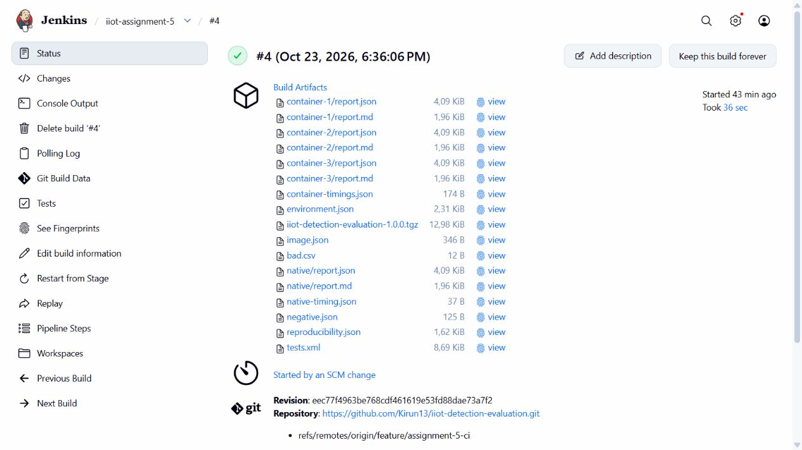
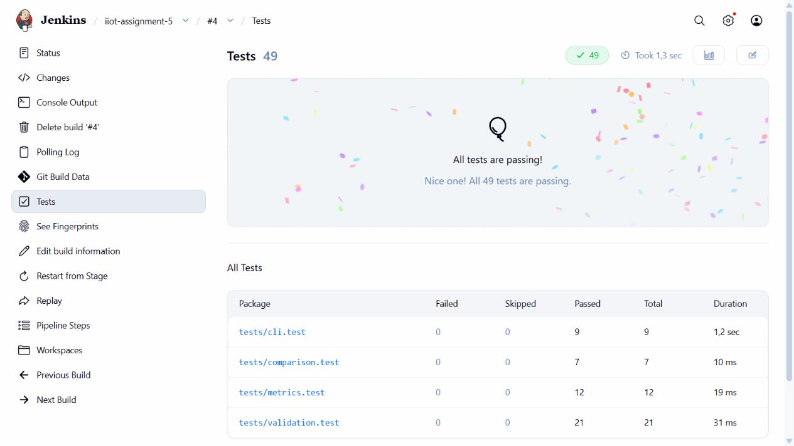

# DevOps и CI/CD для проекта IIoT

Assignment 5 · Онгарбай Нурторе · CSE-2504M

## Часть 1 Theoretical Research Work

Тема: роль DevOps и CI/CD в автоматизации исследовательского проекта по обнаружению атак в IIoT.

### 1 Что такое DevOps цели принципы и преимущества

DevOps — подход к разработке и сопровождению программ, в котором работа над кодом, его проверка и подготовка среды рассматриваются как общий процесс. Разработчики и специалисты по инфраструктуре согласуют способы сборки и запуска приложения. Цель — быстрее получать проверяемые изменения и уменьшать количество ошибок при передаче проекта между участниками [1].

Основные принципы DevOps — совместная ответственность, контроль версий, небольшие изменения и автоматизация повторяющихся действий. После изменения кода команда получает обратную связь от тестов и журналов сборки. Команды установки и проверки сохраняются в проекте, поэтому их можно повторить без устных инструкций. Это полезно и для одного исследователя: через несколько недель проще восстановить порядок запуска своего эксперимента.

В нашем проекте IIoT уже был инструмент для оценки сохранённых предсказаний детектора. Для его проверки нужно установить зависимости, собрать TypeScript, выполнить тесты и сформировать отчёты. DevOps объединяет эти действия в один процесс: ручных операций становится меньше, а ошибки обнаруживаются до использования новых результатов.

### 2 Что такое CI и CD

Continuous Integration, или CI, — практика регулярного объединения изменений с автоматической сборкой и тестированием. В репозитории хранится сценарий проверок. Сервер CI получает новую версию проекта и выполняет этот сценарий: устанавливает зависимости, проверяет код и запускает тесты. Если обязательный шаг завершается с ошибкой, сборка считается неуспешной [2].

Continuous Delivery означает подготовку проверенного приложения к выпуску. После успешных проверок создаётся артефакт: например, npm-архив или Docker-образ. Его дальнейшую публикацию или развёртывание можно запускать после отдельного решения. Continuous Deployment идёт дальше: прошедшие проверки изменения автоматически развёртываются в целевой среде. Поэтому наличие тестов и Docker-сборки ещё не означает, что настроено автоматическое развёртывание.

В нашей работе Jenkins выполняет CI, а затем создаёт архив приложения командой npm pack. Публикация Docker-образа в Docker Hub и автоматическое развёртывание на сервере не настроены. Репозиторий опрашивается раз в минуту; push в отслеживаемую ветку feature/assignment-5-ci вызывает новый запуск. Это важно для демонстрации: локальный Jenkins и агент должны работать, а Docker Engine должен быть доступен для контейнерных стадий.

### 3 Роль DevOps инструментов в исследовательской среде

Исследовательский код часто меняется вместе с гипотезами, параметрами и данными. Если сохранять только итоговую таблицу, позднее бывает трудно определить, какой версией программы она получена. Контроль версий позволяет фиксировать код и настройки, а CI сохраняет историю проверок. Для воспроизведения результата дополнительно нужны версия входных данных и параметры запуска. Одна ссылка на репозиторий без этих сведений недостаточна.

Docker описывает среду выполнения приложения и позволяет запускать его в контейнере [3]. Jenkins выполняет заданные команды и сохраняет их результат [2]. В нашем случае Docker отвечает за запуск CLI с выбранной версией Node.js, а Jenkins — за проверку типов, тесты, сборку образа и сохранение отчётов. В JSON-метаданных записываются ревизия Git, версии программ и хеши файлов. По ним можно проверить, какие входы использовались в конкретном запуске.

Изменение расчёта метрики проверяется до использования новых результатов. При этом тесты не устанавливают правильность исходных меток или отсутствие утечки данных между выборками. За качество данных и постановку эксперимента отвечает исследователь.

### 4 Примеры применения Docker Jenkins и Kubernetes

Docker можно использовать для упаковки программы обработки данных. Например, исследователь передаёт контейнеру два CSV с предсказаниями моделей и получает отчёт с метриками. В нашем проекте этот пример реализован: один и тот же CLI запускался в Windows и в Linux-контейнере. Хеши выходных JSON- и Markdown-файлов совпали. Сами CSV синтетические: предсказания в них заданы вручную, поэтому результат подтверждает работу процедуры оценки, а не эффективность реального IDS.

Jenkins подходит для проверки изменений вычислительного кода. После push он запускает тесты и собирает образ. В нашем проекте намеренно внесена ошибка в формулу F1. Четыре теста обнаружили неверный расчёт, и Jenkins пропустил последующие стадии, включая упаковку приложения. После отмены изменения pipeline снова прошёл. Это пример того, как CI помогает не передавать заведомо ошибочную версию инструмента следующему участнику команды.

Kubernetes управляет запуском контейнерных приложений на кластере: поддерживает заданное состояние компонентов, распределяет ресурсы и помогает восстанавливать работу после сбоев [4]. Для более крупного IIoT-стенда его можно было бы использовать для координатора федеративного обучения и отдельных заданий оценки сегментов. Это возможное продолжение проекта, а не выполненная часть текущей работы. Для небольшого локального CLI достаточно Docker и Jenkins; Kubernetes здесь добавил бы настройку кластера без необходимой для задания пользы.

### 5 Какие проблемы DevOps решает в научной команде

DevOps уменьшает зависимость проекта от ручной настройки и памяти одного участника. Команда получает общие команды запуска, историю изменений и автоматические проверки. Отчёты сохраняются с номером сборки, поэтому проще передать инструмент и установить, как получен результат.

Для нашего IIoT-проекта основная польза — одинаковый порядок оценки и контроль изменений модуля метрик. Docker задаёт среду, Jenkins выполняет проверки, Git связывает запуск с ревизией. Kubernetes имеет смысл рассматривать при появлении нескольких сервисов и вычислительных узлов. Выбор инструментов зависит от масштаба задачи.

### Источники для теоретической части

[1] AWS. What is DevOps? https://aws.amazon.com/devops/what-is-devops/

[2] Jenkins. Pipeline. https://www.jenkins.io/doc/book/pipeline/

[3] Docker. What is Docker? https://docs.docker.com/get-started/docker-overview/

[4] Kubernetes. Overview. https://kubernetes.io/docs/concepts/overview/

## Часть 2 Практическая работа

### Проект и исходная настройка

Использован TypeScript-проект IIoT Detection Evaluation Toolkit из Assignment 3. Его CLI читает CSV, проверяет данные и рассчитывает метрики. Практическая часть продолжает работу над этим инструментом: добавлены Docker и локальный CI через Jenkins.

Установлены зависимости через npm ci и проверена исходная версия. Команда npm test собирает TypeScript и запускает Vitest. Все 49 тестов прошли. Использованы Node.js 22.19.0, Docker Engine 29.6.2 и Jenkins 2.580.1 с Java 21.

### Docker и Jenkins

Созданы Dockerfile и .dockerignore. Образ содержит скомпилированное приложение и рабочие зависимости; запуск выполняется от пользователя node. Jenkins установлен локально, сборки выполняет Windows-агент. Jenkinsfile хранится в GitHub.

Pipeline выполняет: checkout → npm ci → проверка типов → npm test → запуск CLI → сборка Docker-образа → запуск контейнера → сравнение отчётов → npm pack. При ошибке обязательного шага дальнейшие стадии пропускаются. Логи, JUnit и отчёты сохраняются как артефакты.

### Результаты трудности и вывод

Сборка № 4 завершилась успешно за 36,69 с. Пройдены 49 тестов и все 6 сравнений хешей для трёх контейнерных запусков. Некорректный CSV отклонён с кодом 1 без создания отчётов. Ошибка F1 вызвала 4 отказа тестов; после исправления pipeline восстановился.

Основная трудность: Docker Desktop не видел входные файлы в workspace под AppData. Перенос каталога агента в профиль пользователя решил проблему. В результате получен работающий локальный CI. Docker Hub, CD и Kubernetes не настраивались; они указаны в задании как необязательные.

Репозиторий и Jenkinsfile доступны по ссылкам ниже. Скриншоты успешной сборки и тестов приведены на следующей странице.

[Репозиторий](https://github.com/Kirun13/iiot-detection-evaluation/tree/feature/assignment-5-ci) · [Jenkinsfile](https://github.com/Kirun13/iiot-detection-evaluation/blob/feature/assignment-5-ci/Jenkinsfile)

## Скриншоты работающего Jenkins

